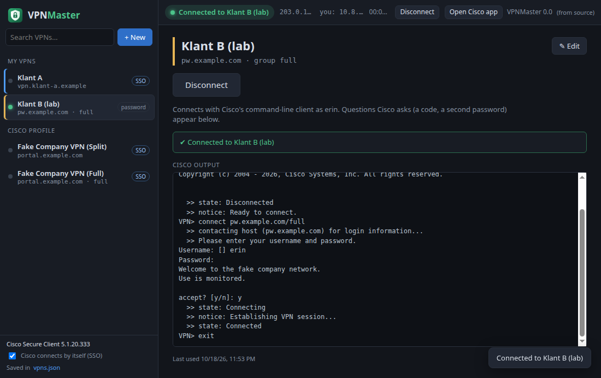

# VPNMaster

A small desktop app on top of **Cisco Secure Client** (AnyConnect). Save the VPNs Cisco keeps forgetting, and connect to any of them in one click, including VPNs that log in through an external login page (SSO).



## Why

Cisco Secure Client lists the servers from the profile your company installed, plus **only the last server you typed yourself**. Connect to a company server once and your own VPN is gone from the list. VPNMaster keeps your own list, and also shows the company's servers, so everything is in one place.

## Install

Download the installer from the [latest release](https://github.com/FarosBelgium/VpnMaster/releases/latest):

| System | File | Data folder |
|---|---|---|
| Ubuntu / Debian | `vpnmaster_<version>_amd64.deb` | `~/.config/vpnmaster/data/` |
| Windows 10/11 | `VPNMaster-Setup-<version>.exe` | `%APPDATA%\vpnmaster\data\` |
| macOS, Apple Silicon (M1 or newer) | `VPNMaster-<version>-mac-arm64.dmg` | `~/Library/Application Support/vpnmaster/data/` |
| macOS, Intel | `VPNMaster-<version>-mac-x64.dmg` | same |

Cisco Secure Client must be installed (your company provides it). VPNMaster finds it in its usual place: `/opt/cisco/secureclient` (Linux, macOS), `C:\Program Files (x86)\Cisco\Cisco Secure Client` (Windows), or the older AnyConnect folders. VPNMaster doesn't change that installation.

- **Ubuntu / Debian**: `sudo apt install ./vpnmaster_<version>_amd64.deb`. VPNMaster appears in your applications menu; `vpnmaster` starts it from a terminal.
- **Windows**: run `VPNMaster-Setup-<version>.exe`. It installs for the current user only, without administrator rights. The installer isn't code-signed, so SmartScreen shows "Windows protected your PC": click **More info**, then **Run anyway**.
- **macOS**: open the `.dmg` and drag **VPNMaster** to **Applications**. The app isn't notarized, so the first time open **System Settings → Privacy & Security** and click **Open Anyway** next to VPNMaster.

### Updates

VPNMaster checks for a new version at startup and every 6 hours. The top right corner shows the version and a button:

- **⬆ Update to x.y.z & restart** (green) when a new version has been downloaded. On Linux it asks for your password, because a `.deb` installs system-wide. On Windows the update also installs by itself the next time you close VPNMaster.
- **⬆ Download x.y.z** on macOS: opens the release page. macOS only lets apps signed with an Apple Developer certificate replace themselves.

Every download is checked against the SHA-512 checksum published with the release.

**Cisco Secure Client** updates itself: when you connect to your company's VPN server, that server installs the version the company chose (Cisco calls this *web deploy*). There is no other source for Cisco's updates: Cisco only gives them to companies with a Cisco contract. The sidebar shows which Cisco version is installed, and VPNMaster tells you when your company's server updated it.

## Using VPNMaster

**+ New** saves a VPN:

- **Server address**: what you would type in Cisco, e.g. `vpn.customer.example`. A group URL (`vpn.customer.example/engineering`) works too.
- **Group** (optional): the tunnel group, the same as Cisco's *Group* dropdown.
- **How do you log in?**
  - **External login (SSO)**: a Microsoft, Okta or other login page. The company VPNs work this way.
  - **Username and password**: optionally save them. Leave the password empty to be asked each time.
- **Colour** and **Notes** to tell your VPNs apart.

Select a VPN and click **Connect**, or double-click it. The status bar at the top shows whether you're connected, the server, your address in the VPN and for how long, with a **Disconnect** button. The tray icon has the same list.

Connected and want another one? VPNMaster asks, disconnects and connects to the new one.

### How connecting works

| Login | What VPNMaster does |
|---|---|
| **External login (SSO)** | Only the Cisco app can show the login page (Cisco's command-line client has no browser), so VPNMaster hands over to it. It sets your VPN as the server the Cisco app has selected and opens the app (or restarts it if it was open, so it reads the new server). When your company's profile allows it, VPNMaster also has the Cisco app **connect by itself** as it opens, so the login page appears without a click; your own Cisco setting is put back right after. Otherwise click **Connect** in the Cisco window. Log in on the page Cisco shows; VPNMaster shows **Connected** as soon as Cisco is connected. Once you are connected, VPNMaster closes the Cisco app again: the VPN stays connected, because Cisco's background service keeps it, not the window. Both are switched on and off at the bottom of the sidebar (**Cisco connects by itself**, **Close Cisco after connecting**). |
| **Username and password** | VPNMaster connects for you with Cisco's command-line client (`bin/vpn`). It answers the group, username and password questions itself. Anything else Cisco asks, such as a one-time code, a second password or a banner to accept, appears in a yellow bar in VPNMaster. The Cisco window is closed while connecting, because Cisco allows only one program to connect at a time, and reopened afterwards if it was open. |

If a VPN saved as *username and password* turns out to need an external login, VPNMaster hands over to the Cisco app by itself.

**Cisco profile**: the servers in your company's Cisco profile are listed under *Cisco profile*. You can connect to them from VPNMaster (through the Cisco app, as they use SSO), but not change them.

### From the command line

```bash
vpnmaster --connect "Customer A"
```

Opens VPNMaster (or uses the window that's already open) and connects to the saved VPN or Cisco profile server with that name or server address. Handy for a keyboard shortcut.

## Where your data is stored

| File | Contents |
|---|---|
| `data/vpns.json` in the data folder above (running from source: `./data/`) | Your saved VPNs |
| `data/settings.json` | Settings, and the Cisco version VPNMaster saw last |
| Cisco's user preferences: `~/.vpn/.anyconnect` (Linux, macOS) or `%LOCALAPPDATA%\Cisco\Cisco Secure Client\VPN\preferences.xml` (Windows) | For an SSO login VPNMaster changes only `DefaultHostName`, `DefaultHostAddress`, `DefaultGroup` (and `DefaultUser` when the VPN has a username), and for a moment `AutoConnectOnStart` (put back once you are connected, or when VPNMaster starts). The first time, the original file is saved next to it with `.vpnmaster-backup` added to its name. |

Example `vpns.json`:

```json
{
  "version": 1,
  "vpns": [
    {
      "id": "6a1e0f3c-2d43-4c1b-9a59-3c3f7b0de0a1",
      "name": "Customer A",
      "host": "vpn.customer-a.example",
      "userGroup": "",
      "auth": "sso",
      "username": "",
      "password": "",
      "color": "#4f9df7",
      "notes": "Log in with your Customer A Microsoft account",
      "lastUsed": 0
    }
  ]
}
```

You can edit the file by hand while VPNMaster is closed. Leave `id` out to have one generated. A plain password is encrypted the next time VPNMaster starts.

## Security

- **Passwords are encrypted** with your keychain (GNOME Keyring / KWallet, macOS Keychain, Windows DPAPI) and stored as `enc:…`. They only work for this user on this machine. Without a keychain the sidebar warns you; then leave the password empty to be asked each time.
- **The password never appears on a command line** or in the window. VPNMaster starts Cisco's client in a pseudo-terminal and types the password only when Cisco asks `Password:`. The window never receives saved passwords.
- `data/` is `0700`, `vpns.json` is `0600`, written atomically. `data/` is in `.gitignore`.
- The window can't access your files or the network, and it loads no remote content.

## Development

```bash
npm install
npm run setup:linux   # once, on Ubuntu 23.10+: lets Electron's sandbox run from node_modules (sudo)
npm start
```

| Command | What it does |
|---|---|
| `npm test` | End-to-end tests against a stand-in for Cisco Secure Client (`test/fake-cisco`): profile and preference files, status and version, connecting with password / one-time code / banner, disconnecting, SSO handover with automatic connect, and the window itself. Your real Cisco installation and preferences are never touched. |
| `npm run test:headless` | The same on a virtual display (needs `xvfb`). |
| `npm run dist` / `dist:win` / `dist:mac` | Builds the installer for Linux (`.deb`), Windows (`.exe`) or macOS (`.dmg` and `.zip`). Each has to be built on its own OS; GitHub Actions builds all three. |
| `npm run icons` | Renders the PNG icons from `src/renderer/assets/icon.svg`. |

For the tests (and to try things out) these environment variables point VPNMaster elsewhere:

| Variable | Default |
|---|---|
| `VPNMASTER_DATA_DIR` | `./data` (source) or `~/.config/vpnmaster/data` (installed) |
| `VPNMASTER_CISCO_DIR` | Cisco's install folder (see Install). When set, the folder is a stand-in like `test/fake-cisco`: `bin/vpn.js`, `bin/vpnui.js`, `vpn/profile/`. |
| `VPNMASTER_PREFS_FILE` | Cisco's user preferences (see above) |

Code: `src/main/anyconnect.js` talks to Cisco, `src/main/store.js` keeps `vpns.json`, `src/main/main.js` is the Electron main process (window, tray, IPC), and `src/renderer/` is the window.

**Releasing**: raise `version` in `package.json`, commit, and push a tag `v<version>`. GitHub Actions (`.github/workflows/build.yml`) tests on Linux, Windows and macOS, builds and installs the installers, and publishes them as a GitHub Release.
